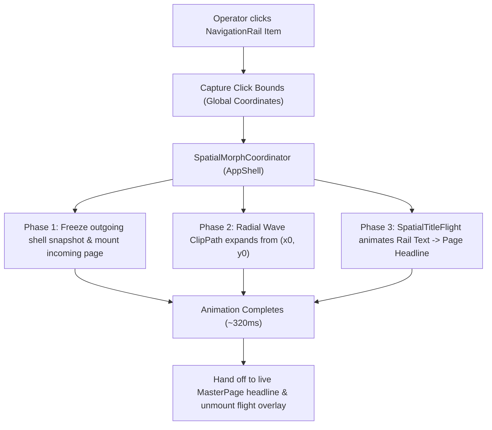

# Spatial Coordinate Morph with Title: Implementation Plan

## 1. Overview & Vision
This implementation delivers a high-end **Spatial Coordinate Morph with Title** transition for the desktop mess management client. When the operator selects a tab on the `NavigationRail`:

1. **Epicenter Capture**: The exact $(x, y)$ coordinate and bounds of the selected rail button and its label are captured via `RenderBox`.
2. **Radial Reveal Mask**: The incoming page expands outward from that click coordinate using an elliptical/radial wipe mask (`CustomClipper<Path>`), cleanly washing over the previous page without jarring full-screen redraws.
3. **Typography Flight Morph**: The destination title text smoothly flies from the navigation rail $(x_{\text{rail}}, y_{\text{rail}})$ across the screen into the page's `MasterPage` headline position $(x_{\text{page}}, y_{\text{page}})$, transitioning seamlessly in font size (11px $\to$ 24px), font weight, color, and tracking.
4. **Seamless Hand-Off**: Once the flight finishes, rendering seamlessly hands off to the static `MasterPage` title with zero jump or layout flash.

---

## 2. Architecture & Components

### Components to Create / Update:

1. **`lib/shared/widgets/layout/spatial_morph_clipper.dart`**:
   - `SpatialRadialClipper`: A `CustomClipper<Path>` that takes an epicenter `Offset origin` and animation progress `double progress (0.0 -> 1.0)`.
   - Computes maximum Euclidean distance to the 4 corners of the canvas, expanding an ellipse with a subtle soft edge.

2. **`lib/shared/widgets/layout/spatial_title_flight.dart`**:
   - `SpatialTitleFlight`: An animated overlay widget that renders the flying title text.
   - Interpolates:
     - Position: `Offset.lerp(originOffset, targetOffset, t)` with `Curves.easeInOutCubic`.
     - Text Style: `TextStyle.lerp(railLabelStyle, pageHeadlineStyle, t)`.
     - Opacity / Shadow: Subtle elevated flight shadow during mid-flight.

3. **`lib/shared/widgets/layout/spatial_morph_shell.dart`**:
   - Manages transition state in `AppShell`:
     - Holds `GlobalKey` references for rail destination items.
     - Controls a 320ms `AnimationController`.
     - Wraps the incoming branch in the `ClipPath(clipper: SpatialRadialClipper)`.
     - Overlays `SpatialTitleFlight` during active transitions.

4. **Integration into `AppShell` & `MasterPage`**:
   - Attach item keys to `NavigationRailDestination` in `AppShell`.
   - Coordinate title target position with `MasterPage`.

---

## 3. Animation Choreography & Curves

* **Total Duration**: 320ms (calibrated for snappy desktop operator workflow).
* **Radial Wave Expansion**: `Interval(0.0, 1.0, curve: Curves.easeOutCubic)`
* **Typography Position Flight**: `Interval(0.0, 0.90, curve: Curves.easeInOutCubic)`
* **Typography Font-Size / Weight Interpolation**: `Interval(0.15, 0.85, curve: Curves.easeOut)`
* **Incoming Page Content Fade-In**: `Interval(0.20, 1.0, curve: Curves.easeIn)`

---

## 4. Edge Cases & Safeguards

* **Rapid Multi-Clicking**: If the operator clicks another tab mid-transition, the controller restarts immediately from the new coordinate without stacking orphaned overlays.
* **Window Resizing / Display Scaling**: Global coordinates are computed per-click at invocation time (`localToGlobal(Offset.zero)`), ensuring accurate tracking across DPI scaling and window size changes.
* **Accessibility / Reduced Motion**: Respects `MediaQuery.maybeDisableAnimationsOf(context)`: instantly renders the target page with 0ms transition when reduced motion is enabled or in unit tests.
* **Widget Test Safe**: Tickers are bounded and respect `pumpAndSettle()`.

---

## 5. Step-by-Step Implementation & Verification

| Step | Action | Success Criteria / Verification |
| :--- | :--- | :--- |
| **Step 1** | Build `SpatialRadialClipper` in `spatial_morph_clipper.dart` | Unit tests verify path covers 0 area at `t=0` and full canvas bounding box at `t=1`. |
| **Step 2** | Build `SpatialTitleFlight` in `spatial_title_flight.dart` | Widget tests verify smooth interpolation of position and typography between two rects. |
| **Step 3** | Integrate coordinate tracking & flight coordinator in `AppShell` | Clicking rail tabs initiates radial reveal from rail coordinate and flies label to header. |
| **Step 4** | Ensure seamless handoff in `MasterPage` | No visual flicker or layout displacement once flight lands on headline. |
| **Step 5** | Verify with full test suite & static analysis | `flutter test` and `dart analyze` pass with 0 issues. |
